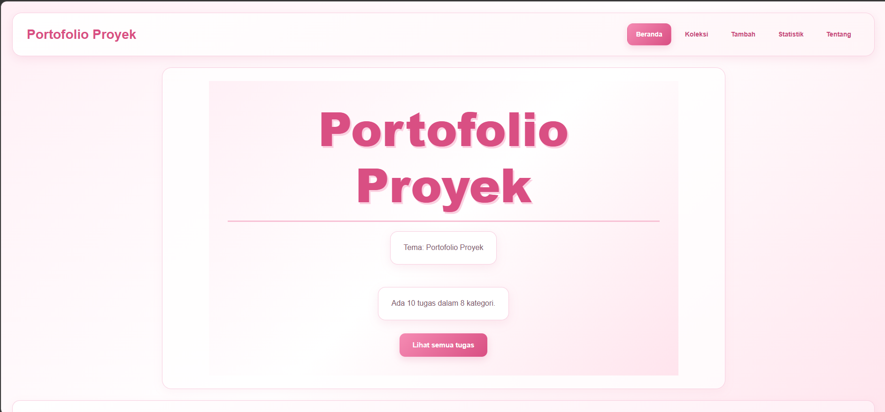

# Nama Aplikasi

Nama: Duwi Putri Wahyuni
NIM: 124140049
Kelas: RA
Tema: Portofolio proyek
Deployment: https://duwi124140049-cyber.github.io/uts-paw/

## Fitur

- Tambah proyek: isi form untuk menambahkan proyek baru ke daftar.
- Cari proyek: cari proyek berdasarkan judul.
- Filter kategori: tampilkan proyek sesuai kategori yang dipilih.
- Hapus proyek: hapus proyek yang sudah tidak diperlukan.
- Statistik kategori: lihat jumlah proyek di setiap kategori.
- Data tersimpan: data disimpan di localStorage, jadi tidak hilang saat halaman di-refresh.

## Menjalankan secara lokal

cd app
npm install
npm run dev

## Konsep React yang dipakai

| Konsep | Lokasi | Kegunaan |
| --- | --- | --- |
| `useState` | `Tambah.jsx` | Menyimpan isi input form |
| `useEffect` | `KoleksiProvider.jsx` | Memuat dan menyimpan data proyek |
| Context API | `useKoleksi` | Membagikan data proyek ke semua halaman |
| Custom hook | `useLocalStorage`, `useKoleksi` | Memisahkan logika agar bisa dipakai ulang |
| `NavLink` | `Layout.jsx` | Navigasi antar halaman dengan penanda menu aktif |
| `useNavigate` | `Tambah.jsx` | Pindah ke halaman daftar setelah proyek ditambahkan |